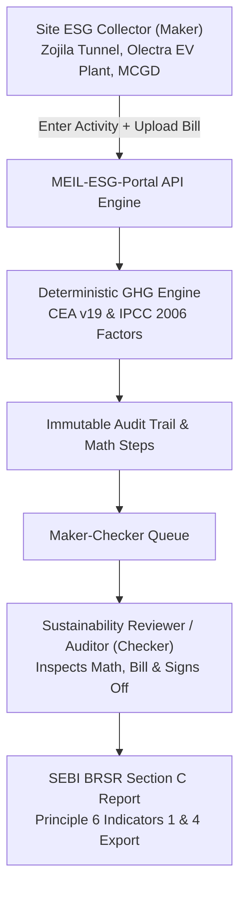

# MEIL-ESG-Portal
### Centralized ESG Data Management & SEBI BRSR Reporting Portal
**Problem Statement Submission for Megha Engineering & Infrastructures Limited (MEIL) — BPUT Hackathon**

---

## 1. Executive Summary & Regulatory Purpose

The **MEIL-ESG-Portal** is a centralized, web-based ESG data governance and reporting solution engineered specifically for multi-subsidiary conglomerates operating large-scale, geographically dispersed infrastructure, hydrocarbon, clean mobility, and power projects across India and international territories.

### Primary Regulatory & Accounting Focus:
* **SEBI BRSR Section C — Principle-wise Performance Disclosure**: Focuses on **Principle 6 (Environment)** essential indicators.
* **GHG Protocol Scope 1 & Scope 2**: Complete mathematical accounting for direct stationary/mobile combustion and indirect purchased grid electricity.
* **Extensible Scope 3 Architecture**: Full schema mapping for all 15 GHG Protocol Corporate Value Chain categories without claiming computation in the prototype.
* **Source-to-Disclosure Traceability**: Every reported figure is deterministically linked to utility invoices/fuel receipts, step-by-step math, and official government emission baselines.
* **Human Expert Review & Assurance Audit (Maker-Checker)**: Built-in verification workflow that assists data integrity without claiming to substitute accredited third-party statutory assurance.

---

## 2. Core Pillars & Architecture



### 1. Hierarchy-Aware Data Ingestion
Reflects MEIL’s real-world corporate structure:
- **Level 1 (Holding):** Megha Engineering & Infrastructures Limited (MEIL Corporate HQ, Hyderabad)
- **Level 2 (Subsidiaries & Core Business Units):**
  - *Olectra Greentech Limited* (Electric Mobility & EV Buses)
  - *Megha City Gas Distribution Holding* (Hydrocarbons & CGD)
  - *MEIL Infrastructure & Tunnel EPC Division*
- **Level 3 (Operational Project Sites):**
  - *Zojila Tunnel EPC Project Site* (Jammu & Kashmir)
  - *Jadcherla EV Bus Assembly Plant* (Telangana)
  - *Krishna District City Gas Network Site* (Andhra Pradesh)

### 2. Verified Calculation Methodologies (Zero Invented Factors)
* **Scope 1 (Direct Fuel Combustion)**:
  $$\text{Emissions } (tCO_2e) = \text{Fuel Quantity} \times \text{Emission Factor } (\text{kg } CO_2e/\text{unit}) \times 0.001$$
  - *Diesel (Stationary DG Sets & Mobile Fleet):* $2.686\text{ kg } CO_2e/\text{L}$ (IPCC 2006 Guidelines for National GHG Inventories, Vol 2 Energy).
  - *Natural Gas / PNG / CNG:* $1.98\text{ kg } CO_2e/\text{SCM}$ (IPCC 2006).
  - *Motor Gasoline / Petrol:* $2.31\text{ kg } CO_2e/\text{L}$ (IPCC 2006).
* **Scope 2 (Indirect Purchased Electricity)**:
  $$\text{Emissions } (tCO_2e) = \text{Purchased Power } (\text{MWh}) \times \text{CEA Grid Factor } (tCO_2e/\text{MWh})$$
  - *Indian National Grid Baseline:* $0.716\text{ } tCO_2e/\text{MWh}$ (*Central Electricity Authority (CEA) CO2 Baseline Database for the Indian Power Sector, User Guide Version 19.0, 2024*).
  - *Captive Rooftop Solar / Clean PPA:* $0.00\text{ } tCO_2e/\text{MWh}$ (GHG Protocol Scope 2 Market-Based Accounting).

### 3. Scope 3 Extensible Architecture Declaration
In strict adherence to project specifications:
> **Declaration:** Scope 3 calculations are *not implemented* in this prototype. The system architecture and database schema include extensible mapping for all 15 GHG Protocol Corporate Value Chain categories (Category 1: Purchased Goods, Category 4: Upstream Freight, Category 6: Business Travel, etc.) to support future phase development.

### 4. Statutory Assurance Disclaimer (Built Into All Views & Exports)
> **Statutory Notice:** This platform provides algorithmic aggregation and mathematical traceability in compliance with SEBI BRSR and GHG Protocol guidelines. It serves internal corporate governance and **does not substitute** accredited third-party statutory assurance under ISAE 3000 / AA1000 standards.

---

## 3. Technology Stack

- **Frontend:** React 18, Vite, Tailwind CSS, Lucide React, Recharts (Responsive, single-page application).
- **Backend API:** Node.js, Express.js, Mongoose ODM, Multer (multipart bill upload), Morgan.
- **Database:** MongoDB (Running locally on `mongodb://127.0.0.1:27017/meil_esg_db`).
- **Reporting Engine:** Structured CSV and print-optimized SEBI BRSR Section C table export.

---

## 4. Default Demonstration Credentials

The database comes pre-seeded with realistic demonstration data clearly tagged with `isDemoData: true`. You can switch between active roles instantly via the top navigation bar dropdown or login with:

| Role | Name | Email | Password | Scope of Authority |
| :--- | :--- | :--- | :--- | :--- |
| **Data Collector (Maker)** | Vikram Sharma | `collector@meil.in` | `meil123` | Site Data Ingestion & Evidence Attachment |
| **BU Reviewer (Checker L1)**| Priya Iyer | `manager@meil.in` | `meil123` | First-Level Verification of Site Figures |
| **Lead ESG Auditor (Checker L2)** | Dr. Arun Nambiar | `auditor@meil.in` | `meil123` | Statutory Review, Traceability & Final Sign-Off |
| **Corporate Admin / CSO** | Sustainability Lead | `admin@meil.in` | `meil123` | Group Governance & Overall BRSR Approval |

---

## 5. Quickstart Guide

### Step 1: Install Dependencies & Seed
Ensure MongoDB is running on your machine:
```bash
# Seed database with official CEA factors and MEIL sample entities
cd server
npm run seed
```

### Step 2: Start Backend Server
```bash
cd server
npm start
# Server listens at http://localhost:5000
```

### Step 3: Start Frontend Client
```bash
cd client
npm run dev
# Frontend runs at http://localhost:3000
```

---

## 6. Verification & Audit Trail Walkthrough

1. **Executive Dashboard (`/dashboard`)**:
   - Inspect consolidated Scope 1, Scope 2, Total Energy Consumed, Renewable Share %, and GHG Intensity per INR Crore Turnover.
2. **Data Ingestion (`/data-entry`)**:
   - Enter fuel/electricity quantities and watch the **live algorithmic formula breakdown** compute before submission.
   - Upload supporting invoices (PDF/images) and check "Demonstration Data".
3. **Maker-Checker Review Queue (`/verifications`)**:
   - As a Reviewer/Auditor, inspect source evidence, verify mathematical steps, and approve or reject submissions with mandatory audit remarks.
4. **BRSR Section C Disclosure Center (`/brsr-report`)**:
   - View SEBI Principle 6 Essential Indicator 1 (Energy) and Essential Indicator 4 (GHG Scope 1 & Scope 2) compliance tables.
   - Export to CSV or print official disclosure reports.
5. **Emission Factor Registry (`/factors`)**:
   - Inspect official citations from CEA India Version 19 and IPCC 2006.
6. **Scope 3 Roadmap (`/scope3`)**:
   - Review architectural matrix of the 15 value chain categories with clear non-claim transparency.
